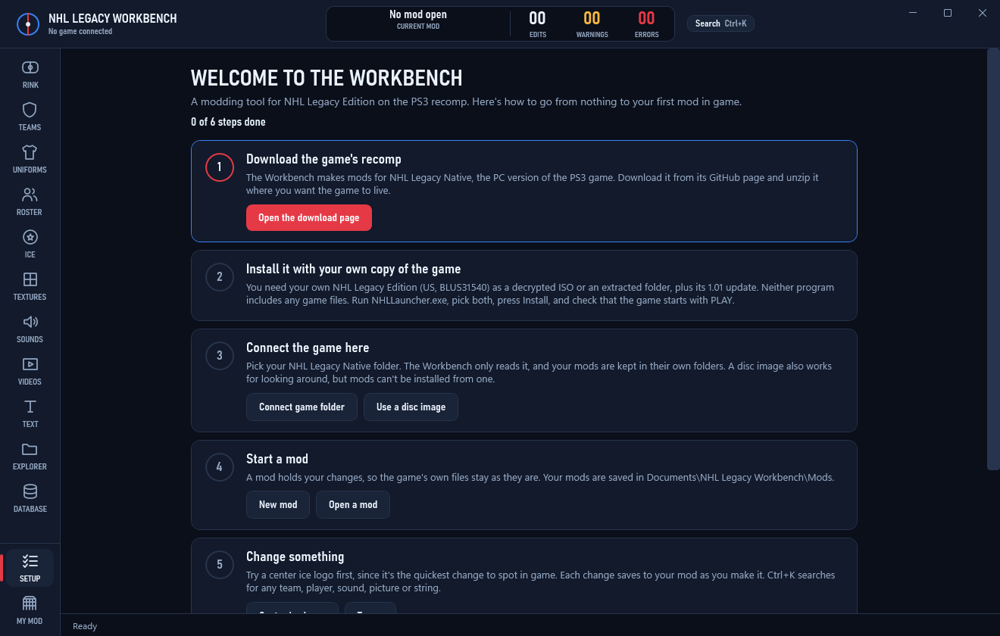

# NHL Legacy Workbench

A Windows modding tool for NHL Legacy Edition, made for the [PS3 recomp](https://github.com/csrpfivem/PS3NHLLegacyRecomp) (NHL Legacy Native).

Browse the game by team, change logos, uniforms, rosters, sounds, text and data tables, then install the result as a normal mod through the game's launcher. Your game files are only read.



> **Early version.** The tool's automated tests pass, and its mods reach the launcher byte for byte, but most kinds of edit haven't been checked in game yet. Keep backups of mods you care about.

This repo holds no game files. You need your own copy of the game.

## Getting started

### What you need

- Windows 10 or 11, 64-bit
- [NHL Legacy Native](https://github.com/csrpfivem/PS3NHLLegacyRecomp/releases), installed and running. Its requirements apply too, including a DirectX 12 graphics card and a CPU with AVX2.
- Your own NHL Legacy Edition (US, BLUS31540) as a decrypted ISO or an extracted folder, plus its 1.01 update

### Download it

1. Get the latest `.zip` from the [Releases page](https://github.com/SonkuModz/NHL-Legacy-Workbench/releases).
2. Unzip it anywhere.
3. Run `NhlLegacyWorkbench.exe`. You don't need to install .NET.

The app isn't code-signed, so Windows may show a SmartScreen warning the first time. To run it anyway, choose **More info**, then **Run anyway**.

Reading textures needs Microsoft's [Visual C++ Redistributable (x64)](https://aka.ms/vs/17/release/vc_redist.x64.exe), which many PCs already have. If logos and textures stay blank, install it.

### Follow the Setup page

The app opens on **Setup** when no game is connected, and F1 brings it back at any time. It ticks off each step as you finish it:

1. **Download the game's recomp.** Unzip NHL Legacy Native where you want the game to live.
2. **Install it with your own copy of the game.** Run `NHLLauncher.exe`, pick your disc and update, press Install, and check that the game starts with PLAY.
3. **Connect the game here.** Pick your NHL Legacy Native folder.
4. **Start a mod.** Your changes go in its own folder under `Documents\NHL Legacy Workbench\Mods`.
5. **Change something.** A center ice logo is the quickest change to spot in game.
6. **Install it and play.** Install from the My Mod page, then press PLAY in the launcher. If your mod has a roster, choose it in the launcher too.

## What it can do

| Page | What it does |
|---|---|
| **Teams** | Each team with all its logos and art together. Save or import it as a folder, and rename a team in every language. |
| **Uniforms** | Every kit bundled together, saved as PNG or DDS. |
| **Roster** | Names, ratings, lines, trades, a league-wide player finder and checks for gaps, with undo. |
| **Ice** | Center ice and ice logos. |
| **Textures** | Every texture in the game. Replace with a picture or DDS. |
| **Sounds** | Play, save as WAV, replace, trim, change volume and fade out, for sounds held in a bank. |
| **Videos** | Watch, save as MP4 or save a frame. These can't be replaced yet. |
| **Text** | Every string in every language, with find and replace. |
| **Explorer** | Search and preview every game file. |
| **Database** | Edit any table, use CSV, see what differs from the game's copy and put it back. |
| **My Mod** | Check, snapshot, export and install your mod, or copy files from another installed mod. |

Textures show what the launcher would use, so turning a mod on or off there changes the pictures when you come back to the Workbench.

Ctrl+K searches everything, and Ctrl+/ lists the keyboard shortcuts.

## Sharing mods

If you replace a texture in a file that comes from another enabled mod, your mod holds that whole file. The same goes for files copied from an installed mod. Ask the mod's maker before you share it.

## For developers

Building from source needs the [.NET 10 SDK](https://dotnet.microsoft.com/download/dotnet/10.0):

```bash
git clone https://github.com/SonkuModz/NHL-Legacy-Workbench.git
```

```bash
cd NHL-Legacy-Workbench
```

```bash
dotnet build NhlLegacyWorkbench.slnx -c Release
```

The app is then at `src\NhlWorkbench.App\bin\Release\net10.0-windows\NhlLegacyWorkbench.exe`. To run the tests:

```bash
dotnet test NhlLegacyWorkbench.slnx
```

Many tests read real game files from a `references` folder that isn't in this repo, and they pass without checking anything when those files are missing. A clean run on a fresh clone therefore proves much less than one with the game files in place.

`docs/2.0-plan.md` covers how the game's files work and what's been built. `docs/references-map.md` lists where the format knowledge came from.

## Credits

- [PS3NHLLegacyRecomp](https://github.com/csrpfivem/PS3NHLLegacyRecomp), the game port this tool targets, and its format notes
- [NHL Modding Studio](https://github.com/puckhead73/nhl-modding-studio), whose research covers many of the file formats and how teams and rosters link up
- [vgmstream](https://github.com/vgmstream/vgmstream), which the EA-XAS sound decoder here is ported from

## Legal

This is an unofficial fan project. It isn't affiliated with or endorsed by Electronic Arts, the NHL or Sony Interactive Entertainment. NHL Legacy Edition and all related marks belong to their owners.

No license has been chosen yet, so the code here isn't licensed for reuse.
